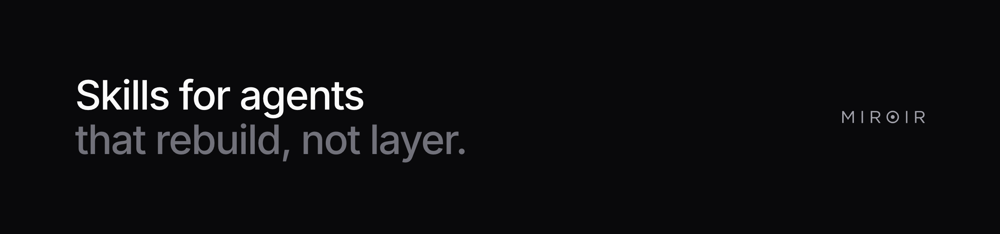
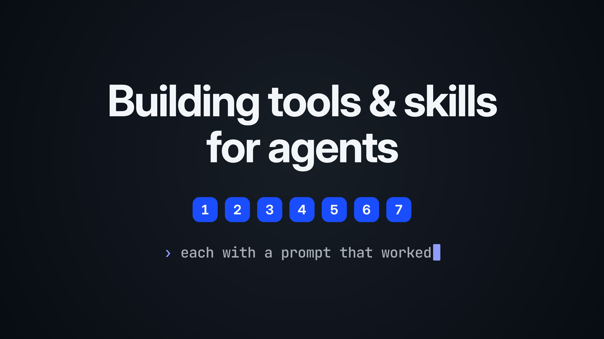

<p align="center"></p>

Most agent skills are slop: long rulebooks that make your agent worse. These are the opposite. At [Miroir](https://miroir.co) we build Miroir OS with frontier coding agents every day, and we kept a skill only where the models needed steering again and again: a few hundred words each, written for senior-level models.

## Skills

| Skill | Use it to | Try |
|---|---|---|
| [`/reshape`](skills/reshape/SKILL.md) | rebuild working code from first principles, with less of it | `/reshape −30% cyclomatic complexity, same perf` |
| [`/review-architectural-design`](skills/review-architectural-design/SKILL.md) | list the design changes a clean sheet would make | `review the architectural design of the sync layer` |
| [`/iterate`](skills/iterate/SKILL.md) | harden a branch with fresh-context reviewers and QA until A− | `/iterate the new export flow` |
| [`/brief`](skills/brief/SKILL.md) | get caught up on a branch as if you had zero context | `catch me up, can we merge?` |
| [`/dogfood`](skills/dogfood/SKILL.md) | watch fresh agents use your tool, fix it from their traces | `dogfood the CLI on 3 real tasks` |
| [`/commit`](skills/commit/SKILL.md) | split work into clean conventional commits | `commit all` |

[`CLAUDE.md`](CLAUDE.md) holds the design rules they lean on: purity over layering, net-negative diffs, invalid states unrepresentable, commands first.

We also use, and recommend, skills by others: Matt Pocock's [`grill-me`](https://github.com/mattpocock/skills/tree/main/skills/productivity/grill-me) and [`grilling`](https://github.com/mattpocock/skills/tree/main/skills/productivity/grilling), [`domain-modeling`](https://github.com/mattpocock/skills/tree/main/skills/engineering/domain-modeling), [`writing-for-agents`](https://github.com/mattpocock/skills/tree/main/skills/productivity/writing-for-agents) and [`wait-what`](https://github.com/mattpocock/skills/tree/main/skills/productivity/wait-what).

## Install

```sh
git clone https://github.com/michael-dm/skills ~/.agent-skills
ln -s ~/.agent-skills/skills/* ~/.claude/skills/
```

Then take what fits from `CLAUDE.md` into your own `CLAUDE.md` or `AGENTS.md`.

## What we learned

Seven lessons from building our tools and skills with agents, each with the prompt that worked (3:40).

<a href="https://github.com/michael-dm/skills/releases/download/video/working-with-agents-1080p.mp4"></a>

## License

MIT
